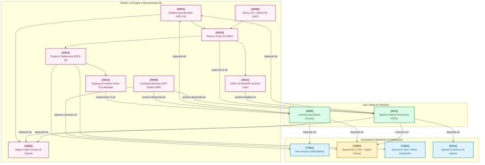

# Cerebro Secundario: Hackathons, Figma Design System y Comparativa de Ideas

Bienvenido al **Segundo Cerebro** del proyecto de ideación para hackathons de vanguardia. Este grafo de conocimiento integra:
1. **Los antecedentes ganadores en EE.UU.**: Cal Hacks 13.0 (*FortWatch*) y HackHarvard 2026 (*FEEL*).
2. **HackaTwin (Sábado 7 de Noviembre de 2026)**: Desglose del evento en Digital House, sponsors (**Twin Finance, Belo, Tether, Avalanche**) y rieles de stablecoins locales (**ARGt, BRAt, COLt**).
3. **Tendencias Globales de Startups Fintech**: *Agentic Finance*, adquisición de Bridge por Stripe ($1.1B USD) y rieles transfronterizos.
4. **Sistema de Diseño y Estética Visual (`docs/design.md`)**:
   - Modelado en Figma para el lienzo infinito.
   - Herramientas de mapeo de Figma a Código (Figma Code Connect y plugin oficial).
   - Estética **Neo-Brutalist ASCII 3D sobre fondo negro** con Three.js `AsciiEffect`.
5. **Comparativa Profunda de las 2 Ideas del Equipo**:
   - **Idea 1 (`[ID09]`)**: *CriteriaLock* (Smart Escrow de bloqueo de plata por criterios de aceptación).
   - **Idea 2 (`[ID10]`)**: *VibeOS* (Centralizador de marca personal omnicanal con portafolio 3D ASCII).

---

## 1. Visualización del Grafo de Conocimiento (Mermaid)



---

## 2. Comparativa Estratégica: ¿Cuál Idea Conviene para el 7 de Noviembre?

| Dimensión | Idea 1: CriteriaLock (`[ID09]`) | Idea 2: VibeOS (`[ID10]`) |
| :--- | :--- | :--- |
| **Concepto Clave** | Bloqueo de dinero en smart contract que solo se libera si se cumplen criterios de aceptación verificados. | Centralizador omnicanal de marca personal (X, LinkedIn, GitHub) con portafolio 3D ASCII y vibe engine. |
| **Alineación con HackaTwin** | **10/10**: Pega directo en los sponsors (Twin Finance ARGt + Tether USDT + Avalanche C-Chain). | **8.5/10**: Fuerte en el track de AI y UX. Requiere integrar un botón de pago onchain/Belo para encajar en Fintech. |
| **Complejidad Técnica en 12h** | Media: Smart contract de depósito en garantía (ERC-20/Solidity) + Frontend en Three.js ASCII + Dashboard de criterios. | Media-Alta: Integración con APIs de redes sociales (X/LinkedIn) + LLM de extracción de tono + Generador 3D. |
| **Impacto de la Demo en Vivo** | Altamente demostrable: se bloquean $50.000 ARGt, se valida el criterio en pantalla y el dinero se desbloquea en vivo. | Visualmente espectacular: el juez ve un portafolio interactivo 3D con su propio GitHub/X analizado en 15 segundos. |
| **Factor Diferenciador** | Elimina las estafas a freelancers y contratistas B2B en LATAM con micro-gas en Avalanche. | Resuelve el síndrome del "programador invisible" con un estilo visual ASCII que nadie más tendrá. |

---

## 3. Guía de Modelado en Figma y Mapeo a Código (`docs/design.md`)

Consulte [`docs/design.md`](file:///c:/Users/pepep/hacktwin/docs/design.md) para acceder a:
1. **La Estructura de Lienzo Infinito en Figma**: Separación en páginas (`00_Tokens`, `01_Components`, `02_Screens`, `03_Playground`).
2. **Herramienta de Mapeo**: Uso de **Figma Code Connect** y el plugin oficial de Figma para Antigravity para transformar frames en componentes React con tipado estricto.
3. **El Motor 3D ASCII**: Implementación lista para producción con Three.js y `AsciiEffect.js`, permitiendo rotar modelos en 3D formados por caracteres de texto reactivos al cursor.

---

## 4. Mantenimiento del Grafo
Para auditar la red y recalcular métricas de conectividad:
```powershell
python scripts/generate_graph.py
```
*(Total actual: 37 nodos indexados, 183 aristas activas).*
